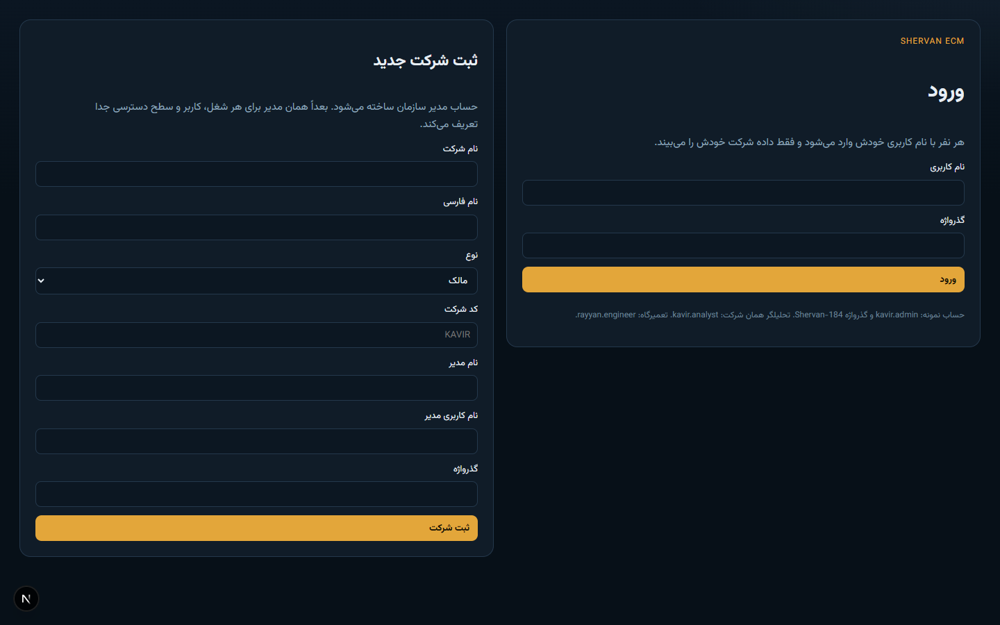
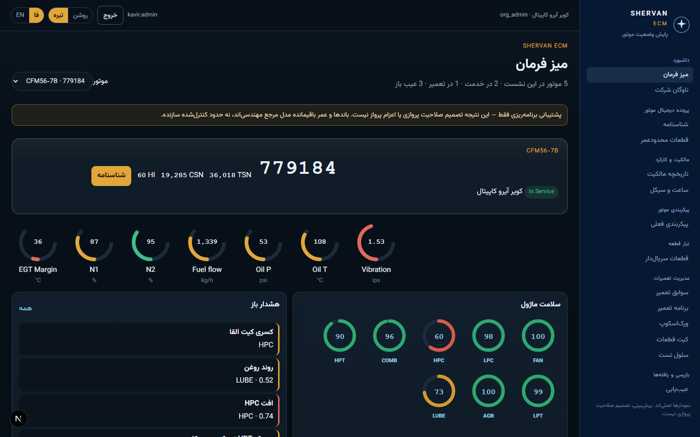
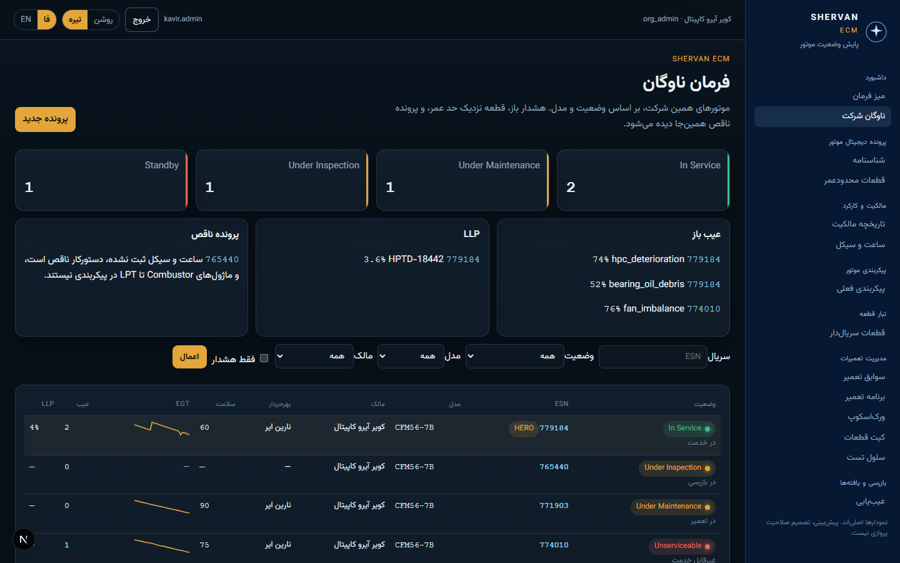
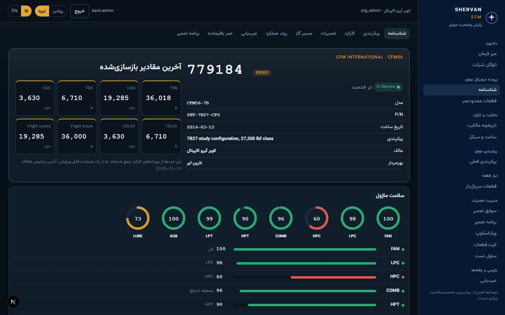
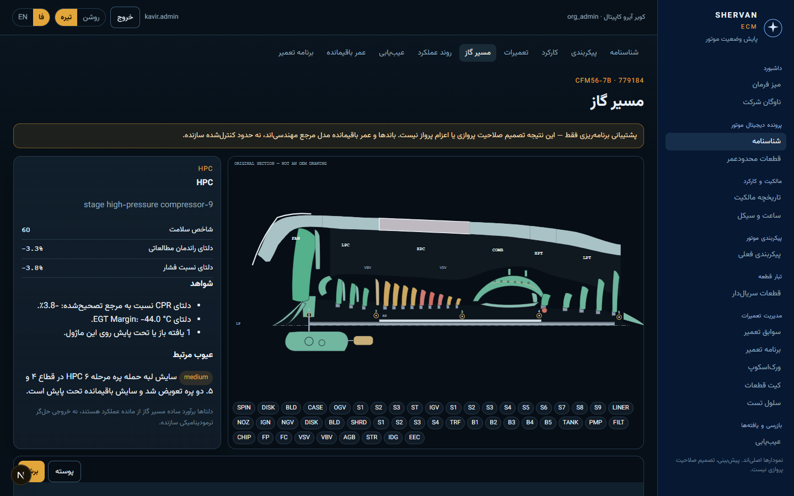
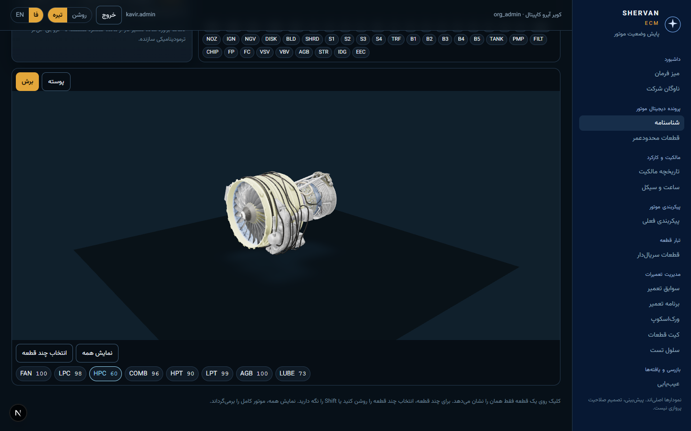
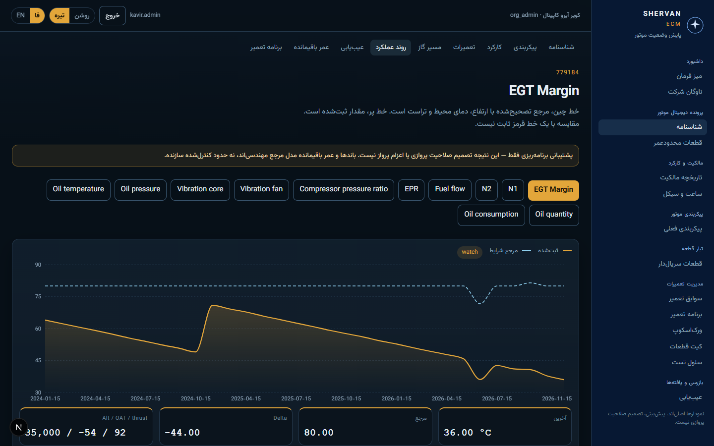

# SHERVAN ECM

Persian-first engine condition monitoring and a digital passport for a fictional CFM56-7B fleet. One desk covers identity, configuration, life-limited parts, shop history, gas-path health, and a detailed three-dimensional engine you can orbit.

شروان ECM سامانه پایش وضعیت و پرونده دیجیتال موتور است. شناسنامه، پیکربندی، قطعات محدودعمر، سوابق تعمیر، روند عملکرد و مدل سه‌بعدی موتور در یک میز فرمان جمع شده‌اند. زبان پیش‌فرض فارسی است و انگلیسی از نوار بالا عوض می‌شود. اصطلاحات مهندسی به شکل استاندارد انگلیسی می‌مانند: EGT Margin، N1، N2، TSN، CSN، LLP، HPC، HPT.

The numbers, shop stories, and health bands are a planning reference for this demo. They are not a certified limit and they are not an airworthiness or dispatch decision.

## Look

Sign-in is per person. A new company can be registered on the same page; the administrator then creates the rest of the seats.



The command desk opens on the engine in focus. Gauges, module health, and open alerts sit on one screen. The header switches language and theme.



## What you can do

| Area | What it holds |
| --- | --- |
| Command desk | The engine in focus, live-style gauges, module health, and open alerts |
| Company fleet | Status counts, missing records, LLP and defect signals, filterable engine table |
| Digital passport | Identity, TSN/CSN, thrust rating, owner and operator, module health |
| Ownership and hours | Custody history plus hours and cycles |
| Configuration and genealogy | Current build and serialized parts |
| Maintenance | Shop records, the visit plan, workscope, kitting, and the test cell |
| Inspection | Findings, borescope, exceedance, and AD/SB |
| Documents | The technical file and the knowledge base, with an extraction queue |
| Gas path | Section drawing, station chips, and the orbitable CFM56 model |
| Performance | EGT margin and the rest of the trend set against a reference line |
| Remaining life | Planning view of life left, alerts, and reports |
| Administration | Company users and the audit trail |

Each organization sees its own engines. Kavir does not open Alborz confidential files. A shop account sees the engines it is authorized to work, not another shop’s internal notes.

### Fleet



### Passport

Serial **779184** is the hero engine, a CFM56-7B in service with Kavir Aero Capital and operated by Narin Air.



### Gas path

The upper half is the section and the station map. Health, efficiency delta, and the open finding for the selected module sit beside it. The lower half is the solid model: fan, core, externals, and harness, lit so the painted surfaces stay readable on the dark desk. Drag to orbit. Module chips along the bottom follow the same health colors as the rest of the desk.





The file the viewer loads is `public/models/engine_cfm56-7b.glb`.

### Performance trend



## Demo accounts

Every seeded account uses the password `Shervan-184`.

| Username | Seat | Organization |
| --- | --- | --- |
| `shervan.admin` | Super administrator | System |
| `kavir.admin` | Organization administrator | Kavir |
| `kavir.analyst` | Data analyst | Kavir |
| `alborz.admin` | Organization administrator | Alborz |
| `narin.ops` | Airline operator | Narin |
| `rayyan.admin` | Shop administrator | Rayyan |
| `rayyan.engineer` | Shop engineer | Rayyan |
| `lanjan.engineer` | Shop engineer | Lanjan |
| `audit.reader` | Read-only auditor | Audit |

Jobs control which modules appear in the side navigation: owner, operator, shop engineer, inspector, analyst, auditor, document controller, and the two administrator seats.

## Run

Node.js 20 or newer.

```bash
npm install
npm run dev
```

Then open [http://127.0.0.1:3000](http://127.0.0.1:3000). `npm run dev` and `npm run local` both bind that address, and sign-in redirects stay on it. On Windows, prefer this address over `localhost`, which often tries IPv6 first.

The first launch creates `data/ecm.db`, applies the Prisma schema, and seeds the fictional fleet and the accounts above when the database is empty. `npm run build` and `npm start` prepare the database the same way.

```bash
npm run typecheck
npm run verify
```

## Stack

- Next.js 15 App Router and React server actions
- Prisma and SQLite
- React Three Fiber for the engine model
- Vazirmatn for Persian text
- Cookie session, with module access decided by job

## Limits

Health indexes, cycle math, and the gas-path deltas are simplified reference models for planning. They are not an OEM thermodynamic solution, not a certified limit, and not a release-to-service decision. The section drawing is original artwork for this product. Shop-visit text is fictional. No real airline, aircraft, or engine identity is used.
